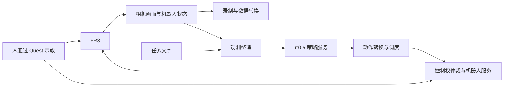

# FR3 / π0.5 部署学习与离线复现

我正在基于 Reactive Diffusion Policy 仓库中的 FR3 / π0.5 相关代码，学习机器人示教采集、数据转换、模型服务调用、动作执行与控制权管理。本仓库持续记录源码理解、离线实验和故障定位过程，便于面试交流。

## 项目做什么

人通过 Quest 遥操作 FR3，系统记录相机画面与机器人状态；自主执行时，π0.5 根据观测与任务文字预测动作，部署程序负责转换、调度并提交给机器人服务。

示教数据可作为后续训练或微调的数据来源；训练和模型服务还涉及外部环境。上图中的自主执行闭环用于解释代码架构，不代表我已经完成真机部署。

## 建议阅读顺序

1. [项目框架与具体场景](architecture.md)：先了解各组件负责什么。
2. [面试知识点手册](fr3_interview_handbook.md)：持续更新的概念、追问和复述练习。
3. [离线实验记录](experiments/README.md)：查看实际执行条件、命令与结果。

## 当前进度与证据

| 内容 | 当前状态 |
| --- | --- |
| 项目框架、观测输入与动作输出 | 已整理源码与文档证据，个人理解待复述 |
| 控制权租约与 token | 已整理源码，预测题暂停，先补整体框架 |
| 控制权单元测试 | 待运行 |
| 采样、数据转换、推理延迟实验 | 待执行 |
| 模型训练或微调、真机部署、任务成功率 | 本学习记录尚无验证结果 |

## 我将逐步积累的成果

- 能从示教到自主执行解释完整链路，并定位关键源码。
- 用离线实验记录采样时序、动作格式、推理延迟及接管行为。
- 每个实验保留预测、命令、实际输出、结论与验证边界。
- 每项改动说明具体问题、修改位置和验证方式，并保留提交记录。

以上为学习目标，完成后再附对应证据。

## 来源与贡献范围

基础项目来自 [xiaoxiaoxh/reactive_diffusion_policy](https://github.com/xiaoxiaoxh/reactive_diffusion_policy)。本仓库用于记录个人学习、复现和后续改动，原项目算法、模型与系统能力归原作者及相应贡献者。

本地工作区已有 FR3 / π0.5 扩展代码；其作者和公开版本对应关系尚未逐项确认，不将其直接计为我的个人开发成果。当前展示内容是架构笔记与学习计划，新增实验与代码修改会单独记录。
