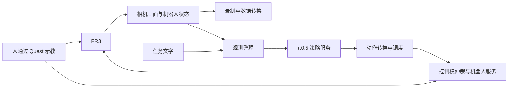

# FR3 / π0.5 部署复现与个人实现

这是我基于 Reactive Diffusion Policy 开展的 FR3 / π0.5 部署复现项目。我沿着示教采集、数据转换、模型推理和动作执行重建整条链路，并在复现中动手实现和验证关键环节。这里记录我追踪的代码、实际跑过的实验，以及我亲手完成的修改和对应的验证结果。

## 项目做什么

人通过 Quest 遥操作 FR3，系统记录相机画面与机器人状态；自主执行时，π0.5 根据观测与任务文字预测动作，部署程序负责转换、调度并提交给机器人服务。

示教数据可作为后续训练或微调的数据来源；训练和模型服务还涉及外部环境。上图中的自主执行闭环用于解释代码架构，不代表我已经完成真机部署。

## 建议阅读顺序

1. [项目框架与具体场景](architecture.md)：先了解各组件负责什么。
2. [面试知识点手册](fr3_interview_handbook.md)：持续更新的概念、追问和复述练习。
3. [离线实验记录](experiments/README.md)：查看实际执行条件、命令与结果。

## 当前进度与证据

| 内容 | 当前状态 |
| --- | --- |
| 项目框架、观测输入与动作输出 | 已整理源码与文档证据 |
| Quest 手柄到 FR3 的遥操作路径 | 已定位消息入口、相对位移映射和机器人服务请求，离线练习待完成 |
| 控制权租约与 token | 已整理源码，预测题暂停，先补整体框架 |
| 控制权单元测试 | 待运行 |
| 采样、数据转换、推理延迟实验 | 待执行 |
| 模型训练或微调、真机部署、任务成功率 | 本学习记录尚无验证结果 |

## 我的复现与实现记录

复现从遥操作链路开始。我用源码入口串起 Quest 位姿、机器人目标和机器人服务。接下来用离线实验逐步验证采样时序、动作格式、推理延迟及接管行为。每条复现记录保留命令和输出，每项个人实现附对应的代码改动与验证方式。目前已发布架构和源码阅读记录。

## 来源与贡献范围

复现基于开源 Reactive Diffusion Policy。原项目见 [xiaoxiaoxh/reactive_diffusion_policy](https://github.com/xiaoxiaoxh/reactive_diffusion_policy)。
