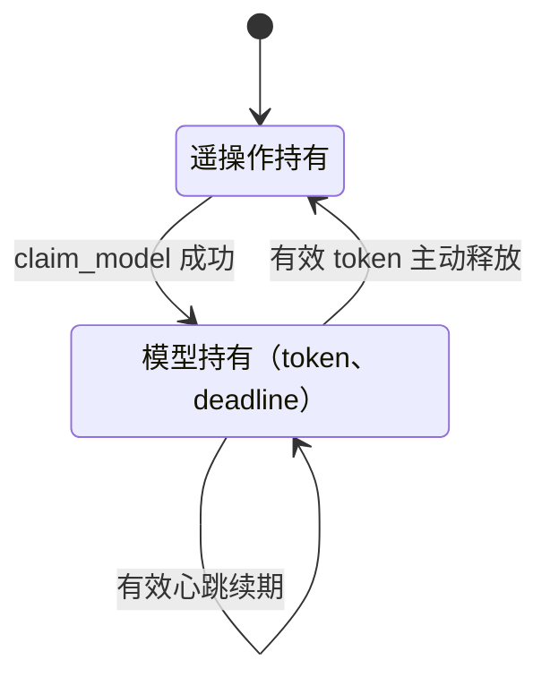

# FR3 / π0.5 面试知识点手册

本手册是后续课程的持久记录。继续学习时先读本文件，再读对应源码和测试。

## 当前学习入口与节奏

2026-11-26 调整：学习者反馈直接预测租约代码过于抽象，先学习项目整体框架，再回到控制权。原预测题暂停，尚未作答；测试尚未运行。

- 先读 [项目总览](architecture.md)，用一个具体任务理解示教、数据、模型与执行的分工。
- 每次只展开一个环节，先讲场景、输入和输出，再读少量源码，最后做一个离线小练习。
- 学习顺序：项目全景 → 人如何遥操作 → 录制保存什么 → 模型输入输出 → 动作如何执行 → 控制权与接管 → 延迟与故障定位。
- 当前学习反馈：缺少整体上下文时，owner/token 的代码题难以理解。这是教学节奏调整依据，不记录为知识错误。
- GitHub 展示仓库：[colorHur/fr3-pi05-deployment-notes](https://github.com/colorHur/fr3-pi05-deployment-notes)，公开。后续将课程进展同步到展示仓库。
- 展示首页源文件：[README](README.md)。同步时保留源码阅读、离线运行、学习者复述三种证据的区别。

## 第零课 · 项目全景

状态：已验证·源码与仓库文档；学习者理解待复习；没有新增实验结果。

FR3 是机器人执行平台，Quest 是人的遥操作输入设备，π0.5 是根据观测与任务指令预测动作的策略模型。当前学习重点是把这些组件连接起来的采集和部署系统。

两条主线：

1. 示教采集：人操作 Quest → 遥操作服务 → FR3；相机与机器人状态通过 ROS2 发布 → 录制器保存示教轨迹。
2. 模型部署：双 RGB、机器人状态和任务文字 → 观测整理 → OpenPI 策略服务 → 动作块 → 调度与动作适配 → 机器人服务 → FR3；新的观测继续反馈。

离线数据转换负责将录制轨迹整理为训练所需格式。当前仓库有 LeRobot v3 转换工具；模型训练或微调及服务运行还涉及外部环境，不能把“有转换和调用代码”记成“本人已训练并部署模型”。

原版 RDP 的触觉与潜在动作训练流程，以及当前 FR3 / π0.5 部署链路，需要分别理解。不能将原版 RDP 的触觉解码能力直接认领为当前 π0.5 观测能力。

典型面试追问（待复习）：模型已经给出动作，部署程序还负责什么？

可复述答案（已验证·源码，待学习者复述）：部署程序整理最新观测，调用策略服务，按时分发动作，把模型动作转换为机器人目标，并处理控制权、异常和日志。模型推理只是闭环中的一个环节。

本节小练习（待回答）：以“夹爪向前移动一点再合拢”为例，指出谁提供人的示范、谁记录观测、谁在自主执行时预测动作、谁真正驱动机器人。仅口头讨论，不连接硬件。

## 第一部分 · Quest 手柄如何控制 FR3

2026-11-27。第一小节只追踪手柄平移。已核读源码，算例待完成，未连接设备。

完整步骤见[部署复现教程](tutorial.md)，从 shell 进入源码目录开始。

- 启动入口为 `tools/start_teleop_collection.sh`，其中遥操作进程运行 `teleop.py`，后者构造 `TeleopServer`。
- `TeleopServer.setup_routes` 中的 `POST /unity` 收到手柄消息后入队。处理循环进入跟踪时保存手柄和机械臂末端的各自起点，再调用 `calc_relative_target` 计算机器人末端目标，最后经 `send_left_arm_waypoint` 向机器人服务提交目标。
- 在平移启用且未达到位移上限时，目标位置 = 机器人起点 + 缩放系数 ×（手柄当前位置 − 手柄起点）。末端目标是机器人希望到达的位置，实际位置须另外从机器人状态读取。
- VS Code 阅读入口为 `reactive_diffusion_policy/real_world/teleoperation/teleop_server.py`。先通过工作区搜索定位 `def calc_relative_target`，本节只读 `relative_translation` 和 `target[:3]`。
- 面试追问待复习：为什么要记录两个起点？可复述答案：先算手柄相对自己的起点移动了多少，再把这段位移加到机器人自己的起点，进入跟踪时手柄的位置无需与机器人末端的位置重合。
- 离线算例待回答：机器人起点 x 为 0.30 m，手柄起点 x 为 0.50 m，之后手柄 x 为 0.54 m，缩放为 0.5，忽略限幅，机器人目标 x 是多少？结果和实际易错点待记录。

## 记录规则

- **已验证·源码**：已阅读当前工作区实现；不等同于运行测试或真机验证。
- **已验证·离线运行**：实际执行过命令，记录条件、输出与结论。
- **待复习**：尚待学习者预测、解释或复述。
- **待验证**：尚未执行的实验或尚未追踪的系统行为。
- 后续每节追加已验证结论、典型追问、可复述答案与实际易错点，并更新学习进度。只记录实际发生的结果。

## 第一天 · 读懂控制权

日期：2026-11-26。当前进度：第一小节，等待两道预测题的回答。

### 第一小节：租约与 token

状态：基础概念已验证·源码；学习者理解待复习；离线测试待运行。

场景：模型正在给 FR3 发送动作，操作者通过 Quest 发来遥操作指令，需要有明确的控制权仲裁。

| 概念 | 当前实现的含义 | 证据 |
| --- | --- | --- |
| owner | 当前控制权归属，初始化为 `teleop`，另一种取值是 `model` | `ControlLease.__init__` |
| 租约 | 模型通过 `claim_model(duration_s)` 获取有期限的控制资格；允许期限为 0.1–2.0 秒 | `claim_model` |
| token | 每次成功申请时生成的随机凭证，与当前模型租约绑定，随模型请求参与校验；不是动作数据或模型推理的文本 token | `claim_model`、`authorize` |
| deadline | 用 `time.monotonic()` 计算的截止时间，用于判断租约是否仍有效 | `claim_model`、`_expire_locked` |
| 心跳 | 模型调用 `heartbeat(token, duration_s)` 续期；通过校验后，截止时间设为本次调用时刻加期限 | `heartbeat` |
| 授权返回值 | `authorize` 返回 `(是否允许, 是否由本次遥操作抢占模型)`；第二项不是动作执行成功标志 | `authorize` 文档字符串 |
| 并发保护 | `threading.Lock` 保护租约状态的检查和修改 | 各公共租约操作 |

可复述的基础答案（已验证·源码，待学习者复述）：

> 租约让模型的控制资格有期限；token 标识当前这次申请。模型发指令时，仲裁器检查当前归属和凭证，心跳用于续期。这里验证的是控制权仲裁，实际机器人如何接管还需要追踪服务调用链。

### 状态图草稿（待回答后共同补全）



待补：停止心跳后到达截止时间的转换、Quest 指令触发的转换、旧 token 被拒绝时是否改变状态。图目前刻意留出预测部分，不代表完整实现。

### 源码与测试入口

- 学习路线：`docs/fr3_deployment_study.md`（原项目工作区），「第一天 · 读懂控制权」。
- 实现：`reactive_diffusion_policy/real_world/robot/control_lease.py`（原项目工作区）：初始化第 11 行；申请第 18 行；心跳第 32 行；授权第 45 行；释放第 61 行；过期通知第 71 行；快照第 78 行；到期检查第 93 行；切回遥操作第 102 行。
- 测试：`tests/test_control_lease.py`（原项目工作区）：申请/心跳/释放第 8 行；重复申请第 17 行；遥操作抢占第 24 行；过期通知第 30 行。
- 当前只核读以上文件；未验证遥操作服务、机器人服务或真机停止行为。

### 离线复现命令（待运行）

在仓库根目录执行，仅使用 Python 标准库，不连接机器人、不启动 ROS2 或模型服务：

```bash
python3 -m unittest discover -s tests -p test_control_lease.py -v
```

执行记录：尚未运行。先由学习者作出预测，再逐个核对测试和源码，最后运行并记录真实结果。

### 自测题与典型面试追问

1. **停止心跳**：申请 0.2 秒租约，不发心跳，0.25 秒后依次调用 `snapshot()`、`authorize("model", token)`。分别会返回什么？只有时间流逝时，这个类会自行启动后台线程修改状态吗？
2. **Quest 抢占与旧 token**：申请后立即调用 `authorize("teleop", None)`，再用原 token 调用 `authorize("model", token)`。两个返回元组分别是什么？旧 token 仍在变量里，是否意味着还持有控制权？
3. **待复习**：为什么既检查 owner 又检查 token？重新申请后，旧请求可能带来什么问题？
4. **待复习**：`time.monotonic()` 与系统墙上时间有什么区别？
5. **待复习**：`poll_expired()` 为什么连续调用两次可能不同？`snapshot()` 是否只有读操作？
6. **待验证·系统调用链**：仲裁拒绝能否直接证明 FR3 已经停止？接管还经过哪些服务？

问题 1、2 的学习者预测：待回答。

问题 1、2 的逐项核对、完整状态图：待下一小节。

实际易错点：尚无学习者回答，不预设已经犯过的错误。

### 一分钟复述（待完成）

在预测、核对、画图之后进行：用自己的话串起「默认归属 → 模型申请 → token → 心跳 → 到期/抢占/释放 → 离线验证边界」。届时记录原话要点、遗漏项及修订答案。

## 后续课程追加区

尚未开始。每节记录：日期、问题、预测、源码证据、实际命令与结果、典型面试追问、可复述答案、实际易错点、待复习项。
